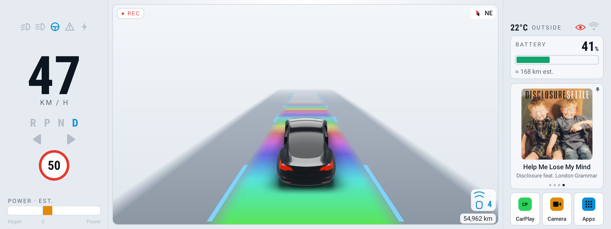
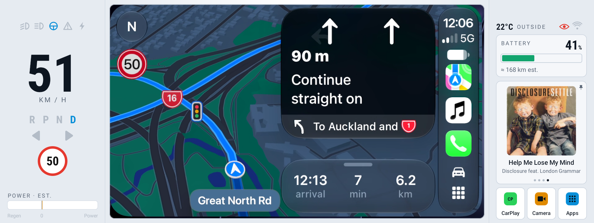

<p align="center"></p>

<h1 align="center">Binnacle</h1>

<p align="center">A <strong>read-only</strong> replacement dash for the Carview / ZIQI "A007" 10.25" Tesla Model 3/Y Android cluster (also sold as Hansshow, Tesery, VJOYCAR and Satonic).</p>

The shipped software is janky and the promised over-the-air updates never came. After trying to patch it, I replaced it instead, with the help of Claude. Binnacle uses the same car data (speed, battery %, gear, odometer, TPMS, lights, parking sensors, doors), hands off properly to wireless CarPlay and the forward camera, and is fully reversible.





*Parked, light and dark themes. The red "● REC" badge and eye show because the optional logger is installed and running.*

## Why "Binnacle"?
On a ship, the binnacle is the stand in front of the helm that holds the compass, lit so the helmsman can read it at a glance.

## Features
- **Live car data, read only:** speed, gear, speed-limit sign, indicators and lights, power and regen bar, tyre pressures (psi or bar), parking sensors, doors, boot and frunk, outside temperature, odometer.
- **Your car in 3D:** Model 3 or Model Y, left- or right-hand drive, in the original dash's colours (extra colours download from this repo). Open doors, boot and frunk show on the car. In Drive it sits on a moving road with headlight glow, and the lane turns blue on Autopilot. When CarPlay or the camera covers the centre, a glow on the left panel keeps Autopilot in view.
- **Laid out for your side:** graphics match your side of the road, with touch targets closer to your free hand.
- **Real battery %:** with a range estimate and charging animation (see below).
- **Efficiency:** Wh/km over the last 5 km, a 15-minute power and regen graph, and this drive's totals.
- **GPS compass.**
- **Parking sensors you can read:** coloured arcs around the car, a STOP sign when you're close, and a sensor card that stays up while the camera is on.
- **Forward camera in the dash,** with a smooth picture.
- **Autopilot attention warning:** a blue LED bar that pulses out from the centre.
- **Wireless CarPlay on your terms:** starts when you tap CarPlay, shows in the centre or full screen, and one tap ends it and rejoins your home Wi-Fi. Optional auto-connect (Apps → Display → CarPlay auto-connect, off by default) looks for your iPhone when the car wakes and gives up quietly after 90 s.
- **Light, dark or Auto theme:** Auto follows the car's screen brightness, so it goes dark at night.
- **Steering-wheel control.**
- **Updates itself** from this repo's releases when you tap Check for updates.
- **Rainbow road on Autopilot.** 'Nuf said.

## What it fixes compared with the stock dash
- **Model Y:** the stock dash only showed a Model 3.
- **Android Settings:** the stock dash hid the Settings app; Binnacle brings it back.
- **Battery %:** on some cars (mine included) the stock battery level is stuck at 77%, and the stock dash shows another field as "km" when it isn't range at all. Binnacle decodes the real % from that field, checked across a full 13% to 100% charge, and switches to the car's own battery level on cars where it works.
- **Camera:** the stock camera could fail with "camera error 4" after a restart and judders on the 56 Hz panel. Binnacle sets up the camera input itself, paces frames evenly and hides the start-up roll.
- **CarPlay that doesn't hijack your phone:** the stock setup grabbed the phone and the unit's Wi-Fi whenever it could. Binnacle only connects when asked (or when you turn on auto-connect).
- **Media and calls on the Tesla:** the stock setup showed only the Bluetooth device name, with no real media or call controls. Album art isn't possible on Android 10.
- **No stray pop-ups:** no more full-screen picture every time a door or the boot opens. Binnacle shows the doors on its own car instead.
- **Warnings that clear on time:** the attention warning goes when the car clears it.
- **A theme that doesn't flip-flop:** Auto waits for the car's light level to settle before switching.

## Planned
- A much improved default dash design.
- Android Auto again.
- Other Android apps in the centre of the screen, such as [Horizon Maps](https://github.com/benbishop028-arch/Horizon-Maps).
- A Tesla-style easter egg.

## Install
**Will it work on my dash?** See [docs/COMPATIBILITY.md](docs/COMPATIBILITY.md).

No computer needed.
1. Download `Binnacle.apk` and `BinnacleCarPlay.apk` from the latest [release](https://github.com/lotech/binnacle/releases/latest). CarPlay is optional; without it, the CarPlay button opens the stock ZLink.
2. Copy them to a USB stick, plug it into the unit, open each one in the unit's file manager and tap it. Android asks once to allow installs from the file manager.
3. Open **Binnacle**. Setup asks about your car, offers to make Binnacle the Home app, asks for location (compass) and the camera, and then sets up the unit: a one-time unlock typed into the unit's EngineerMode (setup gives you Copy buttons), then one tap. Any step can be skipped; **Apps → Advanced → Run setup** shows it again.

Setting up the unit hides the stock camera screen and pop-ups, turns on Android Bluetooth for wireless CarPlay and keeps CarPlay connecting after a restart. **End CarPlay** and **Bluetooth auto-connect** need it too. Each change can be undone under **Apps → Unit**, and all of them are listed in [docs/UNIT-CHANGES.md](docs/UNIT-CHANGES.md).

**Update:** **Apps → Advanced → Updates → Check for updates** (0.8 and later), in Park, over Wi-Fi. It updates Binnacle and its CarPlay together, and keeps your settings. Android asks you to confirm, and the first time to allow Binnacle to install apps. If Play Protect warns, tap **Install anyway** or **Install without scanning**. Details: [docs/UPDATES.md](docs/UPDATES.md).

**Check a download:** both APKs are signed with the same key. `apksigner verify --print-certs Binnacle.apk` should show the SHA-256 certificate digest `14ee8d96b1c63874f0767871f5346178d52fd8497cb813ce7ff5f9c507d4fa84`. Android also refuses an update signed with any other key.

**Remove:** **Apps → Advanced → Remove Binnacle**. The stock dash was never removed and comes straight back.

## The hardware (what the listings don't tell you)
Sold as an "Android 12" 10.25" cluster for the Model 3 and Model Y under several brands. Inside, it's a ZIQI "A007" board.


| | |
|---|---|
| **Android** | **Android 10** (API 29). The About screen says 12, so apps that need Android 11 or 12 won't run. |
| **SoC** | Unisoc UMS512, not MediaTek. |
| **Firmware** | `A007-userdebug` build (Feb 2023), with a fingerprint borrowed from a Vastking tablet. A debug build: SELinux permissive, bootloader unlocked, `su` gives root. ZIQI's update server has nothing for it, so the promised OTA updates don't exist. |
| **Storage** | 64 GB eMMC (about 55 GB for apps and data). |
| **Screen** | 1920 × 720 at 320 dpi. The panel runs at **56 Hz**, so 30 fps video judders unless it's paced (Binnacle paces the camera). |
| **Car data** | Two MCUs: one decodes the Tesla CAN bus and sends it over serial to the stock CAN app (`com.xbs.canapp`), which any app can subscribe to. Brake lights, true range and steering angle aren't in that feed. |
| **Wi-Fi** | One radio. Wireless CarPlay turns it into a hotspot, so the unit drops off your home Wi-Fi while CarPlay is connected. |
| **Bluetooth** | A separate Goodocom module handles calls and audio. Android's own Bluetooth is off as shipped (no Bluetooth LE, so apps such as S3XY Commander can't connect); setting up the unit turns it on for wireless CarPlay. |
| **CarPlay** | Wireless only. ZLink comes preinstalled, and the unit rolls it back to that version at every restart. With `BinnacleCarPlay.apk` installed (built from [xcertplay](https://github.com/shilapi/xcertplay), see `carplay/`), Binnacle uses it instead, draws CarPlay in the dash and hides ZLink from its app list (ZLink stays installed). |
| **Camera** | A TP9950 decoder. Only the TVI 1080p 30 fps input gives a clean picture with the supplied camera. |
| **GPS** | Built in. Its daemon crashes often and, as shipped, writes a large crash dump each time (setting up the unit stops that). |
| **USB-C** | Host only, so no ADB over USB. ADB works over Wi-Fi with no key ([docs/ADB-GUIDE.md](docs/ADB-GUIDE.md)); Binnacle keeps it off the Wi-Fi unless you turn on **Apps → Unit → Network ADB**. |

No stock apps were removed. Changes to the unit outside Binnacle, each with its undo, are in [docs/UNIT-CHANGES.md](docs/UNIT-CHANGES.md).

> **ABSOLUTE RULE — NOTHING TO THE CAR.** Nothing in this project ever sends anything onto the car's CAN bus or otherwise affects the car. The dash *subscribes* to the stock CAN service and only *receives* data. A write to the dash's own MCU is a narrow, owner-approved exception, one pinned message at a time (see `CLAUDE.md`). This is enforced in code (one class, two allowed binder calls: subscribe/unsubscribe) and by build-time guards that refuse to build if any write path is referenced: `app/tools/check_readonly.sh` on the source and `app/tools/check_bytecode.sh` on the compiled classes and APK, with `app/tools/test_guards.sh` checking they still refuse known bypasses (the logger has its own pair in `capture/tools/`). The CarPlay app has its own guard, `carplay/guard/check_carplay.sh`, tested by `carplay/guard/test_carplay_guard.sh`: its only message towards the MCU is the approved call-state broadcast to the CAN app, the same one stock ZLink sends. Never weaken or bypass them.

## Status
In daily use on my 2023 Model 3 since 27 Oct 2026, as the unit's Home app (the stock launcher stays installed as the fallback).
- ✅ Reverse-engineered the stock CAN data and built a **field map** (`docs/FIELD_MAP.md`).
- ✅ The **dash** (`app/`, see `app/README.md`) and an optional read-only **logger** (`capture/`).
- ✅ Android Bluetooth on alongside the stock module, with echo cancellation for the poor microphone.
- ✅ Replaced ZLink with xcertplay for CarPlay, drawn in the dash (centre or full screen).
- ✅ Setup that sets up the unit too, with no computer.
- 🟡 Power and regen values broke with Tesla software 2026.38.6.1 (other tools such as S3XY Commander broke too).

## Layout
| Folder | What |
|---|---|
| `app/` | The dash (installs as `com.xbs.launcher`, so the stock door pop-up stays away; code in `app.binnacle`) |
| `carplay/` | Binnacle's CarPlay (`com.shilapi.xcertplay`), a fork of [xcertplay](https://github.com/shilapi/xcertplay) by shilapi with its full history; its own APK, Gradle build and guard. See `carplay/README.md` |
| `capture/` | Binnacle logger, an optional developer tool that records the car data feed (no location) |
| `mockups/` | HTML mockups of the dash layout, **own artwork only** |
| `docs/` | `COMPATIBILITY.md`, `FIELD_MAP.md` (decoded CAN fields), `ADB-GUIDE.md`, `UNIT-CHANGES.md`, `UPDATES.md` |
| `app/tests/` | Plain-Java tests (tyre pressure, battery decoding), run by every build |
| `buildSrc/`, `gradle/`, `*.gradle.kts` | The Gradle build (see Build) |
| `app/assets/cars/` | The dash's car renders, from a CC BY 4.0 model (see Credits) |

## Binnacle logger
The logger records everything the dash's MCU sends for the last 7 days; it's how the field map was worked out. It isn't installed by default and is only worth having if you want to help the project. It never records location, keeps its logs in its own private storage (uninstalling deletes them), and shows a red eye beside the Wi-Fi icon and a badge in the centre while it records. The dash only starts it if you turn on **Apps → Advanced → Drive logger: start with the dash**. Details: `capture/README.md`.

Install `BinnacleLogger-<version>.apk` from the release by USB stick or `adb install -r`, or build it with `./gradlew :logger:assembleRelease` or `capture/build.sh`. Then open **Binnacle logger** on the unit and tap **Start recording**; **Export logs to Downloads** copies the logs out.
Undo: **Apps → Advanced → Remove drive logger**, or `adb uninstall app.binnacle.logger`.

## Build
Needs JDK 17 and the Android SDK (platform 37); Gradle downloads itself through the wrapper.
```
./gradlew assembleRelease   # dash and logger, signed with ~/.android/debug.keystore:
                            #   app/build/gradle/outputs/apk/release/app-release.apk
                            #   capture/build/gradle/outputs/apk/release/logger-release.apk
./release.sh                # dash, logger and CarPlay, signed with the release key
                            #   -> build/release/Binnacle-<version>.apk, BinnacleCarPlay-<version>.apk, ...
./deploy.sh                 # menu: status, pull, build, publish the GitHub release, car images
```
CarPlay (`carplay/`) is its own Gradle build (Kotlin, Compose and a small native I2C library; needs the NDK): `cd carplay && ./gradlew :mobile:assembleDebug` for a test build, `./gradlew :shared:testDebugUnitTest` for its tests. `release.sh` signs it with the dash's release key, which the dash needs to draw CarPlay through its signature-protected service.

Every build runs the read-only guards and tests (`buildSrc/src/main/java/app/binnacle/gradle/Guards.java`): the iCloud-copy check, `tools/check_readonly.sh` and `tests/run.sh` before compiling, then `tools/check_bytecode.sh` on the compiled classes and the packed APK, and it refuses any library in the APK. Any failure stops the build and leaves no APK. Only release APKs are built (a debug variant splits the dex, which the guard refuses; app bundles aren't checked). Shared settings such as the signing key are in `buildSrc/src/main/java/app/binnacle/gradle/BinnacleApp.java`. `-Pbinnacle.appId=app.binnacle` builds the dash under another package name (see `app/README.md`). `app/build.sh` and `capture/build.sh` still build the same APKs without Gradle.

## Safety & reversibility
- Binnacle installs as a normal app and is set as the default Home; the stock launcher stays installed as the fallback. No system-partition changes. Remove it from **Apps → Advanced**, or switch Home back with `adb shell su 0 cmd package set-home-activity com.xbs.launcher1/.MainActivity`.
- What it does on the unit itself is pinned by the guards: a fixed list of commands through the unit's own ADB (`LocalShell`: end CarPlay, Bluetooth auto-connect, Wi-Fi scans, screenshots, and the opt-in unit setup and ADB firewall, each with its undo), and the camera decoder's two input nodes in `/sys/ziqi/camera`. All are listed in [docs/UNIT-CHANGES.md](docs/UNIT-CHANGES.md).

## Credits
3D car model by Ameer Studio (https://sketchfab.com/uchiha.321abc), source: https://sketchfab.com/3d-models/tesla-2018-model-3-5ef9b845aaf44203b6d04e2c677e444f, CC BY 4.0 (https://creativecommons.org/licenses/by/4.0/). Modified: recoloured, mirrored for RHD, posed, rendered.

Model Y renders (dark grey right-hand drive bundled, the rest downloaded from the release): based on "2021 Tesla Model Y" (https://sketchfab.com/3d-models/2021-tesla-model-y-59e2ead369984b1a85c800ff6cf6789d) by tonielpro520 (https://sketchfab.com/tonielpro520), CC BY 4.0 (https://creativecommons.org/licenses/by/4.0/). Modified: recoloured, doors separated and hinged, mirrored for right-hand drive, posed, rendered.

CarPlay: built from [xcertplay](https://github.com/shilapi/xcertplay) by shilapi and its contributors (GPL-3.0), with fixes from open upstream pull requests by BBleae and code-new-bie; changes for this unit are listed in `carplay/README.md`.

The in-app credit is under **Apps → Advanced → About**.

## Security
Please report security problems privately, not in a public issue: see [SECURITY.md](SECURITY.md).

## Licence
Code: GNU General Public License version 3 (see `LICENSE`), for the dash, the logger and CarPlay alike. Releases up to and including 0.8 were MIT; from 0.9 the whole repository is GPL-3.0, to match xcertplay (© shilapi and contributors; upstream credits are kept in `carplay/README.md` and in each commit). Car renders in `app/assets/cars/` and the release packs: CC BY 4.0, from 3D models by Ameer Studio (Model 3) and tonielpro520 (Model Y), modified (see Credits). Not affiliated with Tesla, ZIQI or any head-unit vendor; "Tesla", "Model 3" and "Model Y" are used only to say which car this is for.
